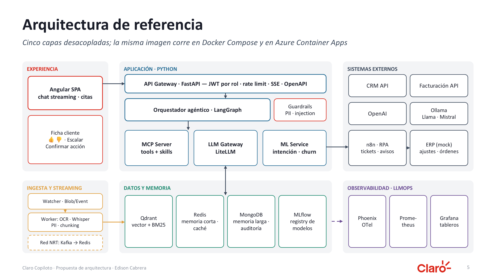

# Claro Copiloto

Asistente de IA generativa para asesores de atención y retención de una operadora de telecomunicaciones: responde con **citas a la fuente**, consulta **CRM y facturación** mediante herramientas **MCP**, clasifica la intención, sugiere la **oferta de retención** según la política vigente y **escala a un humano** cuando la confianza es baja o el tema es sensible.

> Prueba técnica · Líder Técnico AI Senior. Todos los datos del caso son **sintéticos**; los insumos entregados para la prueba no se publican en este repositorio (ver [Datos](#datos)).



## Estado

| Fase | Componente | Estado |
|---|---|---|
| 1–2 | Planteamiento y arquitectura ([SAD](docs/)) | ✅ |
| 4 | [Mocks CRM / Facturación / ERP](apps/mocks/) (contrato, 429, 503, 409/403) | ✅ |
| 4, 7 | [Servidor MCP](apps/mcp-server/): 11 tools, skill de retención, confirmación firmada, circuit breaker | ✅ |
| 5–6 | [Ingesta](apps/ingestion/): carpeta vigilada, OCR, Whisper, PII, chunking, índice híbrido, versionado, frescura ≈ 5 s | ✅ |
| 6–8 | [API y agente](apps/api/) LangGraph: RAG híbrido, guardrails, human-in-the-loop firmado, memoria, auditoría · [LiteLLM](infra/litellm/) | ✅ |
| 8 | [Evaluación golden](eval/): exactitud 100 %, groundedness 0,99, recall 0,98, p95 TTFT 1,5 s | ✅ |
| 3 | [Front Angular](apps/frontend/) del asesor y del supervisor: chat con streaming, citas con versión, ficha del cliente, confirmación de acciones, 👍/👎, escalamiento · Vitest 94 % + Playwright E2E | ✅ |
| 9 | [Modelos de ML](ml/): intención SVM (F1 0,92 GroupKFold, cascada con LLM), churn (AUC 0,71, señal), MLflow con promoción, drift PSI + Evidently · [ml-service](apps/ml-service/) | ✅ |
| 11 | [Observabilidad y RPA](infra/): trazas OpenTelemetry → Phoenix (sin PII, `trace_id` en la auditoría), métricas Prometheus, 12 alertas probadas con promtool, 2 tableros Grafana como código, n8n (acción confirmada → ERP, escalamiento, alertas → acción) | ✅ |
| 10, 12, 14 | [CI/CD](docs/04_ci_cd.md): lint, pruebas con cobertura ≥ 70 %, Bandit, gitleaks, Trivy (0 CVEs críticas en imágenes y dependencias), imágenes no root en GHCR por SHA · despliegue en la máquina de demo con gate de ML, smoke, golden y rollback automático | ✅ |
| 13 | Terraform (Azure) con `validate` / `test` | ⏳ |

## Inicio rápido

> Se completa a medida que se construyen los servicios.

```bash
# 1. Variables de entorno (agregar OPENAI_API_KEY)
cp .env.example .env

# 2. Copiar los insumos de la prueba a data/raw (no versionados)
python scripts/bootstrap_data.py --source "<ruta a Insumos_Prueba_Consultor_IA>"

# 3. Levantar la solución completa
docker compose up -d --build

# 4. Carga inicial de la base de conocimiento (la ingesta la procesa sola)
python scripts/sembrar_inbox.py

# 5. Entrenar y registrar los modelos en MLflow; el ml-service los toma al recargar
cd ml && uv sync && uv run python -m copiloto_ml entrenar && cd ..
curl -X POST http://localhost:8001/modelos/recargar
```

| Servicio | URL local |
|---|---|
| **Interfaz del asesor** | **http://localhost:8080** (A-001 / SUP-001 con `API_DEMO_PASSWORD`) |
| API del Copiloto | http://localhost:8000/docs (login: A-001 / SUP-001 con `API_DEMO_PASSWORD`) |
| LiteLLM (gateway) | http://localhost:4000 (clave `LITELLM_MASTER_KEY`) |
| CRM mock | http://localhost:8081/docs |
| Facturación mock | http://localhost:8082/docs |
| ERP mock | http://localhost:8083/docs |
| Servidor MCP | http://localhost:8090/mcp · estado: http://localhost:8090/health |
| Qdrant (índice) | http://localhost:6333/dashboard |
| MLflow (experimentos y registry) | http://localhost:5000 |
| Phoenix (trazas del agente) | http://localhost:6006 → proyecto `claro-copiloto` |
| Grafana (tableros y alertas) | http://localhost:3000 (lectura anónima; admin con `GRAFANA_ADMIN_PASSWORD`) |
| Prometheus · Alertmanager | http://localhost:9090 · http://localhost:9093 |
| n8n (flujos RPA) | http://localhost:5678 |
| ML service (intención, churn, drift) | http://localhost:8001/docs · estado: http://localhost:8001/health |
| Ingesta | `docker compose exec ingesta-worker python -m ingesta estado` |

## Estructura del repositorio

```
claro-copiloto/
├── apps/
│   ├── frontend/        Interfaz Angular del asesor (chat streaming, citas, ficha, feedback)
│   ├── api/             FastAPI + agente LangGraph + prompts versionados
│   ├── mcp-server/      Tools y skills MCP (CRM, facturación, retención, ERP)
│   ├── mocks/           Servicios simulados CRM, facturación y ERP según OpenAPI
│   ├── ingestion/       Watcher + worker: extracción, OCR, Whisper, PII, chunking, indexado
│   └── ml-service/      API de intención y churn, monitoreo de drift
├── ml/                  Entrenamiento, comparativa de algoritmos y fine-tuning
├── eval/                Golden dataset y evaluación automática (gate de CI)
├── infra/
│   ├── terraform/       IaC Azure: módulos + ambientes dev/prod
│   ├── litellm/         Ruteo multi-LLM y fallback
│   ├── observability/   Prometheus, tableros y alertas de Grafana
│   └── n8n/             Flujos de automatización (RPA)
├── data/                inbox/ (carpeta vigilada) · raw/ (insumos, fuera de Git)
├── scripts/             Utilidades: carga de datos, demo
├── docs/                SAD, presentación y runbooks
└── .github/workflows/   CI/CD
```

Cada carpeta principal tiene su propio `README.md` con propósito, ejecución y pruebas.

## Documentación

| Documento | Contenido |
|---|---|
| [docs/00_control_resumen.md](docs/00_control_resumen.md) | Control del documento y resumen ejecutivo |
| [docs/01_planteamiento.md](docs/01_planteamiento.md) | Problema, actores, casos de uso, KPIs, riesgos, business case |
| [docs/02_arquitectura.md](docs/02_arquitectura.md) | Vistas, flujo agéntico, RAG, multi-LLM, ML, seguridad, despliegue, ADR |
| [docs/03_gestion_proyecto.md](docs/03_gestion_proyecto.md) | Plan, equipo, RACI, gobierno, criterios de aceptación, riesgos |
| [docs/04_ci_cd.md](docs/04_ci_cd.md) | Pipeline CI/CD, gates de calidad, hallazgos de seguridad y configuración del self-hosted runner |
| [docs/presentacion/](docs/presentacion/) | Presentación de la propuesta (PPT y PDF) |

El PDF consolidado (SAD) se genera desde estos Markdown con [docs/build/build_sad.py](docs/build/build_sad.py).

## Stack

Python 3.12 · FastAPI · LangGraph · FastMCP · LiteLLM (OpenAI + Ollama) · Qdrant · Redis · MongoDB · scikit-learn · MLflow · Evidently · n8n · OpenTelemetry · Phoenix · Prometheus · Grafana · Angular · Docker Compose · Terraform (Azure) · GitHub Actions.

Justificación de cada decisión: [docs/02_arquitectura.md · ADR](docs/02_arquitectura.md#216-decisiones-clave-adr-resumidos).

## Datos

Los documentos, transcripciones, audios, CSV, especificaciones OpenAPI y golden dataset entregados para la prueba **no se versionan** en este repositorio público. Para ejecutar la solución, cópielos localmente con `scripts/bootstrap_data.py`; quedan en `data/raw/`, excluido por `.gitignore`.

## Seguridad

- Ningún secreto se versiona: `.env` está excluido y en CI se usan GitHub Secrets.
- La PII se anonimiza en la ingesta y nunca sale del servidor MCP hacia el LLM ni hacia los logs.
