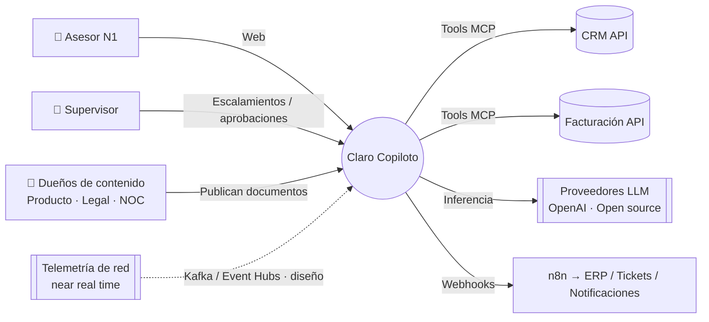
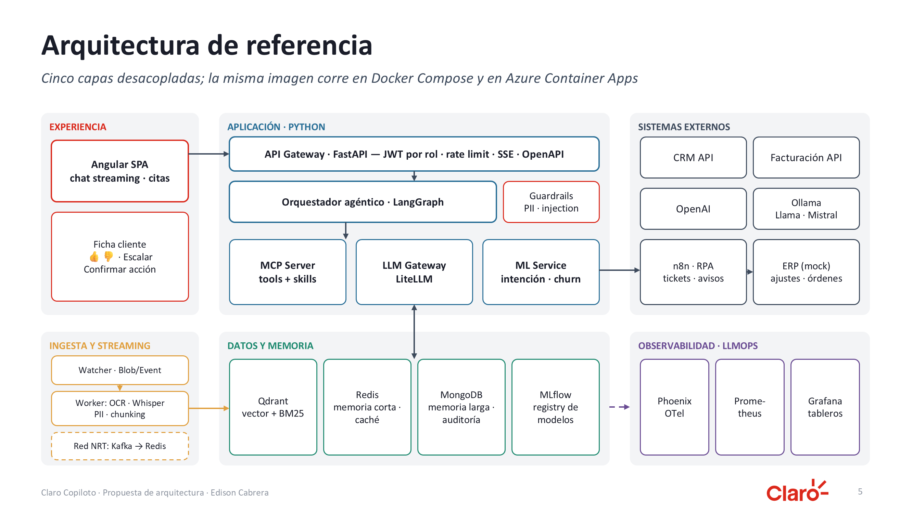
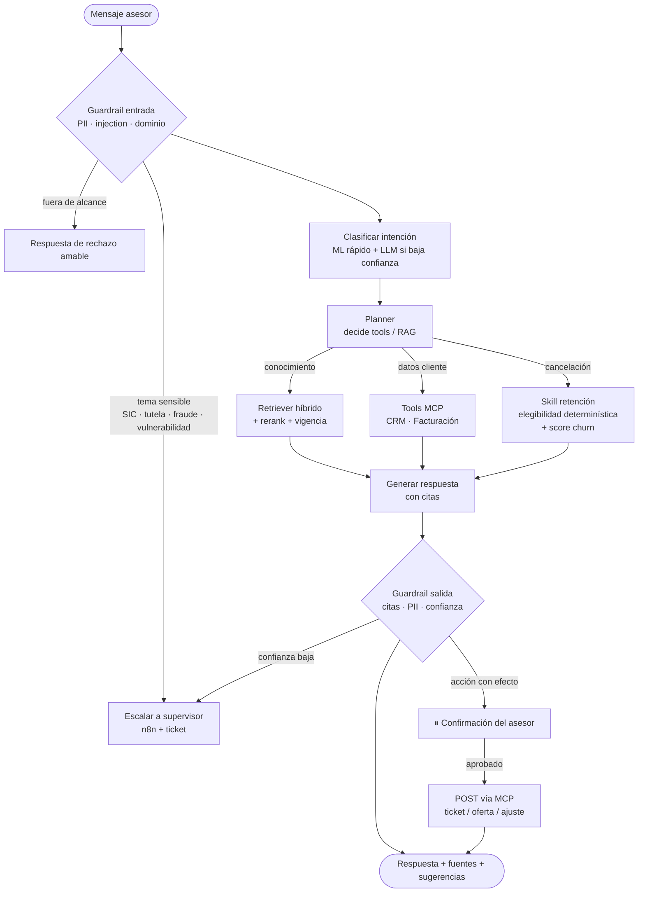
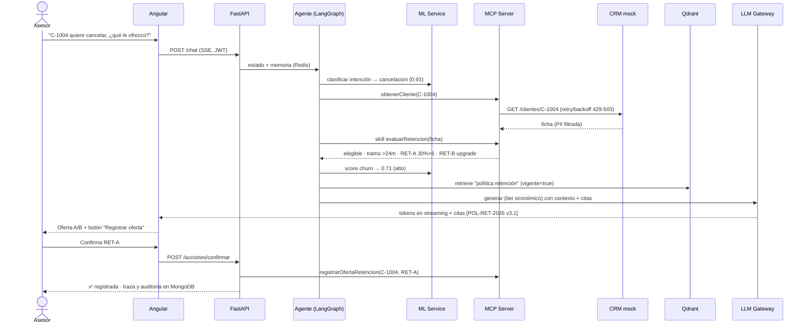
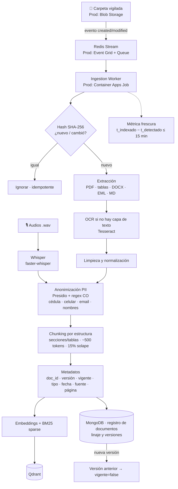
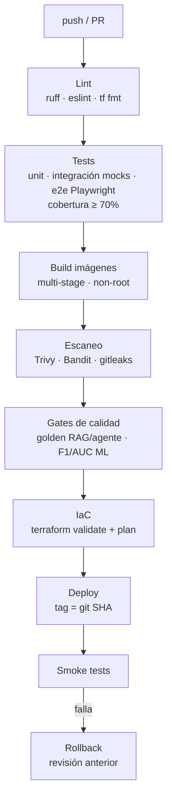

# 2. Arquitectura de la solución

Principios: **(1)** el LLM razona y redacta, las reglas de negocio se ejecutan en código determinístico;
**(2)** toda respuesta es trazable (fuente, versión, modelo, prompt, costo); **(3)** misma arquitectura
local (Docker Compose) y nube (Terraform/Azure); **(4)** sin vendor lock-in: proveedores LLM, vector DB y
nube detrás de interfaces.

---

## 2.1 Vista de contexto (C4 nivel 1)

## 2.2 Vista de componentes (C4 nivel 2)

<!-- landscape: Vista de componentes (C4 nivel 2) -->

*Fuente editable del diagrama: slide 5 de la presentación. Cada capa se detalla en la tabla siguiente y en las secciones 2.3 a 2.13.*

| Componente | Responsabilidad | Tecnología |
|---|---|---|
| Front | UX del asesor, streaming SSE, feedback, confirmación de acciones | Angular 18 + Nginx |
| API | Autenticación JWT por rol (asesor/supervisor/admin), rate limit, contratos OpenAPI | FastAPI (async) |
| Orquestador | Grafo de estados del agente, límite de pasos, human-in-the-loop | LangGraph |
| MCP Server | Expone tools y skills con esquema tipado; único punto de acceso a sistemas | FastMCP |
| LLM Gateway | Ruteo multi-LLM, fallback, reintentos, límites de gasto, registro de costo | LiteLLM |
| Guardrails | PII in/out, prompt injection, temas fuera de alcance, validación de citas | Presidio + reglas + LLM judge |
| Retriever | Búsqueda híbrida + reranking + filtros de vigencia | Qdrant + cross-encoder |
| Ingesta | Pipeline por eventos, idempotente por hash, versionado | Python worker + Redis Streams |
| ML Service | Clasificador de intención y modelo de churn como API, drift | scikit-learn + MLflow + Evidently |
| Memoria | Corta: Redis (TTL). Larga: MongoDB | Redis 7 · MongoDB 7 |
| RPA | Flujos de negocio tras escalamiento o acción confirmada | n8n |
| Observabilidad | Trazas de cada paso del agente, métricas, alertas, tableros | OpenTelemetry · Phoenix · Prometheus · Grafana |

---

## 2.3 Flujo agéntico (grafo LangGraph)

**Límites de autonomía**
- Máximo 6 pasos por turno y 3 llamadas a la misma tool (detección de bucles → corta y escala).
- Tools de **lectura**: autónomas. Tools de **escritura** (`crearTicket`, `registrarOfertaRetencion`, `aplicarAjuste`): solo con confirmación explícita en la UI; el agente propone, el asesor dispone.
- Reglas de negocio en el tool, no en el prompt: mora > 30 días, 1 oferta/12 meses, ≥ 3 tickets técnicos → visita prioritaria, ajuste > $50.000 → supervisor, alto valor ≥ $150.000 → mesa especializada.
- Confianza = f(score de reranking, cobertura de citas, acuerdo clasificador ML/LLM). Bajo umbral → escalar (Política de Escalamiento, numeral 2).

## 2.4 Secuencia — caso retención (GQ-26, cliente C-1004)

<!-- landscape: Secuencia del caso de retención (GQ-26, cliente C-1004) -->

## 2.5 Pipeline de ingesta y frescura

- **Versionado**: `doc_id` lógico (ej. `catalogo_planes`) + `version` (detectada del documento o incremental). El retriever filtra `vigente=true`; versiones viejas quedan para auditoría.
- **Chunking**: tablas (tarifas, matriz de retención) se indexan completas como un chunk con su encabezado; textos por sección. Cada chunk lleva el título de la sección para mejorar la recuperación.
- **Transcripciones**: además de indexarse, alimentan el resumen/clasificación y el dataset de evaluación.
- **Datos de red near real time (diseño)**: Event Hubs/Kafka → Stream Analytics/Flink → estado por zona en Redis → tool `consultarEstadoRed(zona)`. Así el Copiloto sabe de incidentes masivos (ej. Chapinero) sin esperar el correo del NOC.

## 2.6 RAG

| Decisión | Elección | Alternativas | Trade-off |
|---|---|---|---|
| Embeddings | `text-embedding-3-small` (OpenAI) | `-large`; bge-m3 local | Costo muy bajo y buen español; `-large` mejora poco para un corpus pequeño. bge-m3 queda como opción on-prem |
| Vector DB | **Qdrant** | pgvector, Azure AI Search, Chroma | Híbrido denso+sparse nativo, filtros por payload, liviano en Docker, OSS (sin lock-in). En Azure productivo se evalúa AI Search (administrado) |
| Búsqueda | Híbrida (semántica + BM25) con fusión RRF | Solo vectorial | Códigos (E-202, LOS, RET-A, $109.900) se pierden en solo-vectorial |
| Reranking | Cross-encoder multilingüe local (top-20 → top-5) | Cohere Rerank, LLM rerank | Sin costo por llamada, ~100 ms; sube precisión en top-k |
| Filtros | `vigente=true`, `tipo`, `servicio` (hogar/móvil) | — | Evita citar el catálogo v1 |
| Prompt | Instrucciones de sistema + contexto delimitado + "responde solo con el contexto, cita [n]" | — | Separación instrucciones/datos contra injection |
| Anti-alucinación | Validador de citas post-generación + umbral de confianza → "no encontrado, escalo" | — | Sacrifica cobertura por exactitud (correcto en telco regulada) |

## 2.7 Estrategia multi-LLM (LiteLLM)

| Tarea | Modelo primario | Fallback | Razón |
|---|---|---|---|
| Clasificación de intención | **ML clásico** (TF-IDF + LR) | LLM económico si confianza < 0,7 | ~1 ms y costo cero para el 80 % de los casos |
| Respuesta RAG estándar | OpenAI tier económico (ej. gpt-4.1-mini) | Llama/Mistral local (Ollama) | Mejor relación calidad/costo/latencia |
| Razonamiento multi-tool / retención | OpenAI tier alto (ej. gpt-4.1) | tier económico | Solo cuando el planner detecta ≥ 2 tools o cálculo |
| Resumen de cierre | tier económico | local | Tarea simple, asíncrona |
| LLM-as-judge (evals) | tier alto | — | Mayor fidelidad de evaluación |

- Router por **tarea + complejidad + presupuesto**; fallback automático ante timeout/429/5xx; circuit breaker por proveedor.
- Modelos configurables por variables (no se hardcodean nombres). Claude, Gemini o Azure OpenAI entran agregando una entrada en el config de LiteLLM: **sin cambiar código**.
- **Caché semántico** en Redis (similitud ≥ 0,95 + mismo filtro de vigencia) para preguntas frecuentes de política.

## 2.8 Memoria

| Tipo | Almacén | Contenido | Retención |
|---|---|---|---|
| Corto plazo | Redis | Mensajes del turno, estado/checkpoint del grafo, ficha de cliente cacheada | TTL 2 h |
| Largo plazo | MongoDB | Resumen por interacción (sin PII), preferencias, ofertas presentadas, historial | Según política de datos |
| Auditoría | MongoDB | Traza de decisión: pregunta, fuentes+versión, tools, modelo, prompt_version, costo, acción confirmada | 5 años (regulatorio) |
| Feedback | MongoDB | 👍/👎 + comentario → dataset de mejora | Indefinido |

## 2.9 Machine Learning clásico

| Modelo | Datos | Algoritmo | Métrica gate | Uso en el agente |
|---|---|---|---|---|
| Intención | tickets.csv (`descripcion` → `categoria`) | TF-IDF n-gramas de caracteres + **SVM lineal calibrado** | F1 macro ≥ 0,80 (baseline 0,92) | Ruteo rápido y barato |
| Churn 90d | clientes_churn.csv (+ agregados de tickets) | **Regresión logística** (retador: CatBoost) | AUC ≥ 0,75 (baseline 0,70) | Prioriza retención y Mesa Especializada |

**Comparativa de algoritmos (validación honesta, 21-nov-2026)**

| Intención · GroupKFold por descripción | F1 macro | Churn · StratifiedKFold 5 | AUC |
|---|---|---|---|
| Naive Bayes (Complement) | 0,81 | Regresión logística | **0,70** |
| Regresión logística | 0,83 | CatBoost | 0,70 |
| **SVM lineal** | **0,92** | Random Forest | 0,68 |
| Random Forest | 0,72 | LightGBM | 0,68 |
| | | HistGradientBoosting | 0,67 |

Hallazgos: (1) solo 164 descripciones únicas en 3.816 tickets → un split aleatorio da F1 0,97 por **fuga**; se valida agrupando por descripción. (2) **Ruido de etiquetas**: la misma descripción aparece en varias categorías → limpieza por voto mayoritario. (3) Churn queda bajo la meta con las variables disponibles: se reporta con transparencia y se usa como señal de priorización, nunca como decisión automática (la elegibilidad la decide la política). Mejora prevista: más variables, calibración, señales de transcripciones, análisis de supervivencia.
**Fine-tuning**: el clasificador de intención es el candidato para comparar SVM vs LLM con prompt vs LLM con fine-tuning (F1, costo, latencia).

MLflow (tracking + registry, stages Staging/Production) · servido por FastAPI · Evidently (PSI) compara datos de inferencia vs entrenamiento → alerta en Grafana → reentrenamiento programado (n8n cron) o por umbral de drift.

## 2.10 LLMOps y monitoreo de agentes

- **Prompts versionados** en el repo (`prompts/*.yaml` con versión semántica) y registrados en cada traza.
- **Evaluación**: golden dataset (30) → exactitud por puntos clave, groundedness (LLM judge), recall@k, éxito de tools. Corre en CI como **gate**: si baja del umbral, no se despliega.
- **Trazas** OpenTelemetry → Phoenix: cada nodo del grafo, tool, tokens, costo, latencia, modelo.
- **Monitoreo de agentes**: tasa de éxito de tareas, errores/reintentos de tools, bucles cortados, acciones bloqueadas por política, escalamientos, costo y latencia por ejecución → Prometheus → Grafana + alertas.
- **Feedback loop**: 👎 → cola de revisión → nuevos casos al golden dataset / ajuste de prompts o chunks.

## 2.11 Seguridad y cumplimiento (Ley 1581)

| Amenaza | Control |
|---|---|
| Fuga de PII al LLM o logs | Presidio en ingesta y en salida de tools; `numero_documento`, `celular`, `email` nunca salen del MCP server; masking en logs/trazas |
| Prompt injection | Delimitadores de contexto, detector de patrones, tools en allow-list, sin ejecución de acciones sin confirmación |
| Acceso indebido | JWT con roles; supervisor requerido para ajustes > $50.000; API keys de sistemas en Key Vault |
| Consulta de terceros | Solo titular validado en sesión; regla de escalamiento |
| Auditoría | Toda respuesta y acción queda en MongoDB con versión de fuente, modelo y prompt |

## 2.12 Despliegue: local y Azure

La solución se empaqueta en las mismas imágenes Docker para ambos entornos; solo cambian la configuración y los servicios administrados que reemplazan a los contenedores locales.

| Componente | Local · `docker compose up` | Azure · Terraform (dev / prod) |
|---|---|---|
| Cómputo (front, api, mcp, ml, litellm) | Contenedores con healthcheck | Container Apps + KEDA autoscaling, revisiones para canary |
| Mocks de sistemas | CRM, Facturación y ERP en contenedor | Integración real detrás de la misma interfaz MCP |
| Fuentes documentales | Carpeta vigilada | Blob Storage + Event Grid |
| Cola de eventos | Redis Streams | Storage Queue / Service Bus |
| Worker de ingesta | Proceso en loop | Container Apps Job (event-driven) |
| LLM | OpenAI + Ollama (perfil opcional) | Azure OpenAI / OpenAI |
| Memoria y datos | Redis, MongoDB y Qdrant en contenedor | Azure Cache for Redis, Cosmos DB (API Mongo), Qdrant en ACA o AI Search |
| Registro de imágenes | GHCR | ACR |
| Secretos | `.env` local (fuera de Git) | Key Vault + Managed Identity |
| Observabilidad | Phoenix · Prometheus · Grafana | App Insights · Log Analytics · Managed Grafana |

**¿Por qué Azure?** Azure OpenAI (residencia de datos, contratos empresariales, mismos modelos), Container Apps (serverless de contenedores con KEDA y revisiones para blue/green), Key Vault y Managed Identity nativos. **¿Por qué contenedores y no Functions?** Cargas con modelos cargados en memoria (reranker, ML) y conexiones largas (SSE) → contenedores; el disparo de ingesta sí es por evento.

## 2.13 CI/CD (GitHub Actions)

- **Sin caída**: Container Apps con revisiones múltiples → tráfico 10 % → 100 % (canary) o blue/green; rollback = mover tráfico a la revisión anterior. Local: `docker compose` con healthchecks y tag por SHA.
- **Evidencia en demo**: self-hosted runner en la máquina de demo → un commit (cambio de prompt o código) llega al ambiente local en minutos.

## 2.14 Escalabilidad y resiliencia (preguntas del jurado)

| Pregunta | Respuesta de arquitectura |
|---|---|
| ¿10.000 asesores concurrentes? | API y agente stateless (estado en Redis) → escala horizontal con KEDA por RPS; Qdrant con réplicas/sharding; cuotas LLM multi-región/PTU; caché semántico (30–40 % de preguntas repetidas de política); ML local sin costo por llamada; streaming para bajar latencia percibida |
| ¿Falla el proveedor LLM? | LiteLLM: reintento → fallback a otro modelo/proveedor → modelo local → degradación a "modo búsqueda" (muestra fragmentos citados sin generar) |
| ¿Se degradó la calidad tras cambiar un prompt? | Gate de golden dataset en CI + evaluación online por muestreo + alerta si cae 👍 o groundedness; rollback de `prompt_version` |
| ¿Cómo no se expone PII? | Anonimización en ingesta, filtrado en el MCP server, masking en logs, test automático que busca PII en respuestas |
| ¿Agente fallando o fuera de política? | Métricas de bucles, acciones bloqueadas, errores de tools y tasa de éxito con alertas; auditoría por traza |
| ¿Cuándo reentrenar el ML? | Drift PSI > 0,2, caída de F1/AUC en ventana etiquetada, o cadencia mensual; promoción solo si supera al modelo en Production |

## 2.15 FinOps (estimado referencial)

Conversación típica: 4 turnos · ~3.000 tokens de entrada (contexto RAG) y ~300 de salida por turno.

| Escenario | Costo/conversación |
|---|---|
| 100 % tier alto | más alto (referencia) |
| **Ruteo (80 % económico, 20 % alto) + caché + ML para intención** | **objetivo < USD 0,02** |

Controles: presupuesto por usuario/día en LiteLLM, costo registrado en cada traza, tablero de costo por conversación y por modelo.
*Los precios exactos se validan con la lista vigente del proveedor al momento del deploy.*

## 2.16 Decisiones clave (ADR resumidos)

| # | Decisión | Alternativa descartada | Motivo |
|---|---|---|---|
| ADR-01 | RAG + tools + ML clásico | Fine-tuning como fuente de conocimiento | Contenido cambiante, necesidad de citas |
| ADR-02 | LangGraph | CrewAI, AutoGen, cadena lineal | Grafo explícito, checkpoints, HITL, control de pasos |
| ADR-03 | MCP para tools | Funciones embebidas en el agente | Desacople, reutilización por otros agentes/canales, contrato tipado |
| ADR-04 | LiteLLM como gateway | SDK directo de cada proveedor | Multi-LLM, fallback y costo sin cambiar código |
| ADR-05 | Qdrant | pgvector / AI Search | Híbrido nativo, OSS, portable |
| ADR-06 | Redis + MongoDB | Solo uno | Patrones de acceso distintos (latencia vs documentos/auditoría) |
| ADR-07 | Phoenix + Prometheus/Grafana | Langfuse self-host | Langfuse v3 requiere Postgres+ClickHouse+MinIO: pesado para local; Phoenix es un contenedor y nativo OTel. Langfuse cloud viable en prod |
| ADR-08 | n8n para RPA | Airflow / Power Automate | Liviano, visual, webhooks; Airflow sobra para el volumen del MVP |
| ADR-09 | Azure Container Apps | AKS | Menos operación, KEDA incluido; AKS cuando la escala lo justifique |
| ADR-10 | Angular | React/Streamlit | Experiencia del equipo, tipado fuerte, apto para app empresarial |

## 2.17 Glosario técnico

> Términos de negocio y conceptos generales de IA: ver glosario 1.12 del planteamiento.

### Arquitectura y patrones

| Término | Definición |
|---|---|
| **C4** | Modelo de diagramas de arquitectura por niveles: contexto (1), contenedores/componentes (2), código. |
| **ADR** (Architecture Decision Record) | Registro breve de una decisión de arquitectura, su alternativa descartada y el motivo. |
| **Stateless** | Servicio que no guarda estado en memoria entre peticiones; permite escalar horizontalmente agregando réplicas. |
| **SSE** (Server-Sent Events) | Protocolo HTTP para enviar datos del servidor al navegador en flujo; se usa para el streaming de tokens. |
| **TTFT** (Time To First Token) | Tiempo hasta que el usuario ve el primer token de la respuesta; latencia percibida. |
| **p95** | Percentil 95: el 95 % de las peticiones tarda igual o menos que ese valor. |
| **Circuit breaker** | Patrón que deja de llamar temporalmente a un servicio que falla para evitar cascadas de errores. |
| **Backoff exponencial** | Reintentos con esperas crecientes (1 s, 2 s, 4 s…) ante errores temporales. |
| **Retry-After** | Cabecera HTTP que indica cuántos segundos esperar antes de reintentar tras un 429. |
| **HTTP 429 / 503** | 429: límite de solicitudes excedido. 503: servicio temporalmente no disponible. |
| **Idempotencia** | Propiedad de una operación que produce el mismo resultado si se ejecuta varias veces (evita duplicar tickets u ofertas). |
| **Degradación controlada** | Reducir funcionalidades de forma ordenada ante fallas, sin dejar al usuario sin servicio. |
| **Vendor lock-in** | Dependencia de un proveedor que dificulta cambiarlo; se mitiga con interfaces y componentes abiertos. |
| **Event-driven** | Arquitectura donde los procesos reaccionan a eventos (ej. "archivo nuevo") en lugar de ejecutarse manualmente. |

### Agentes y LLM

| Término | Definición |
|---|---|
| **LangGraph** | Framework para construir agentes como grafos de estados explícitos, con checkpoints y pausas para confirmación humana. |
| **Planner** | Nodo del agente que decide qué ramas ejecutar (RAG, tools, retención) según la intención y la pregunta. |
| **Checkpoint** | Estado guardado del agente que permite pausar, reanudar o auditar una ejecución. |
| **MCP** (Model Context Protocol) | Protocolo abierto para exponer herramientas (tools), recursos y skills a agentes con un contrato tipado y reutilizable. |
| **Tool / Skill** | Tool: función que el agente invoca (ej. `obtenerCliente`). Skill: capacidad compuesta con lógica de negocio (ej. `evaluarRetencion`). |
| **FastMCP** | Librería Python para implementar servidores MCP. |
| **LiteLLM** | Gateway que unifica la API de múltiples proveedores LLM, con ruteo, fallback, presupuestos y registro de costo. |
| **Multi-LLM / ruteo** | Elegir dinámicamente el modelo por tarea, complejidad y costo. |
| **Fallback** | Modelo o proveedor alterno que se usa cuando el principal falla o excede límites. |
| **Tier económico / alto** | Niveles de modelos de un proveedor: más baratos y rápidos vs. más capaces y costosos. |
| **Ollama** | Herramienta para ejecutar modelos open source (Llama, Mistral) localmente en contenedor. |
| **LLM-as-judge** | Usar un LLM para calificar automáticamente la calidad o fidelidad de otra respuesta. |
| **Caché semántico** | Reutilizar respuestas previas cuando una nueva pregunta es semánticamente equivalente, evitando llamar al LLM. |
| **Prompt versionado** | Prompt guardado con número de versión en el repositorio y registrado en cada traza, para comparar y revertir. |

### RAG y datos

| Término | Definición |
|---|---|
| **Embedding** | Vector numérico que representa el significado de un texto; textos similares quedan cerca. |
| **Base vectorial** | Base de datos optimizada para buscar vectores similares (ej. Qdrant). |
| **Qdrant** | Base vectorial open source con búsqueda híbrida (densa + dispersa) y filtros por metadatos. |
| **BM25** | Algoritmo clásico de búsqueda por palabras clave; capta códigos exactos (E-202, RET-A). |
| **Búsqueda híbrida** | Combina búsqueda semántica (embeddings) y por palabras clave (BM25). |
| **RRF** (Reciprocal Rank Fusion) | Método para fusionar los rankings de varias búsquedas en uno solo. |
| **Reranking / cross-encoder** | Segundo modelo que reordena los fragmentos recuperados según su relevancia real para la pregunta. |
| **Chunking** | División de documentos en fragmentos (chunks) indexables; aquí por sección o tabla, ~500 tokens con 15 % de solape. |
| **Recall@k** | % de preguntas en las que la fuente correcta aparece entre los k primeros resultados recuperados. |
| **Metadatos / filtro de vigencia** | Atributos de cada chunk (documento, versión, `vigente`, tipo, página); el filtro excluye versiones obsoletas. |
| **Linaje** | Trazabilidad de un dato desde su origen: chunk → documento → versión → hash. |
| **Hash SHA-256** | Huella digital de un archivo; permite detectar si cambió y hacer la ingesta idempotente. |
| **OCR** | Reconocimiento óptico de caracteres para extraer texto de imágenes o PDF escaneados (Tesseract). |
| **Whisper / ASR** | Modelo de reconocimiento de voz (Automatic Speech Recognition) para transcribir audios. |
| **Presidio** | Librería de Microsoft para detectar y anonimizar PII en texto. |
| **Redis / Redis Streams** | Base en memoria de baja latencia; Streams es su cola de eventos para la ingesta. |
| **TTL** (Time To Live) | Tiempo tras el cual un dato expira automáticamente (memoria corta de sesión). |
| **MongoDB** | Base documental (JSON); aquí para memoria larga, auditoría y feedback. |
| **Kafka / Event Hubs** | Plataformas de streaming de eventos a gran escala; Event Hubs es el servicio administrado de Azure. |
| **NRT** (Near Real Time) | Datos procesados con segundos o pocos minutos de retraso. |

### ML y MLOps

| Término | Definición |
|---|---|
| **MLOps** | Prácticas para entrenar, versionar, desplegar y monitorear modelos de ML de forma reproducible. |
| **LLMOps** | MLOps aplicado a LLM: versionado de prompts/modelos, evaluación, trazas, costo y guardrails. |
| **MLflow** | Plataforma de tracking de experimentos y registro de modelos con etapas (Staging, Production). |
| **Model registry** | Catálogo versionado de modelos con su etapa y métricas. |
| **Champion / challenger** | Modelo en producción vs. modelo retador; el retador se promueve solo si lo supera. |
| **TF-IDF** | Representación de texto que pondera palabras o n-gramas por su frecuencia y rareza. |
| **N-gramas de caracteres** | Secuencias de 3–5 letras como variables; robustas a variaciones y errores de escritura. |
| **SVM lineal** | Clasificador que busca la frontera de máxima separación entre clases; muy eficaz en texto. |
| **Calibración** | Ajuste para que la salida del modelo sea una probabilidad confiable (usada como confianza en el ruteo). |
| **Regresión logística** | Modelo lineal de probabilidad; interpretable por sus coeficientes. |
| **CatBoost / LightGBM** | Algoritmos de gradient boosting sobre árboles para datos tabulares; CatBoost maneja variables categóricas de forma nativa. |
| **GroupKFold** | Validación cruzada que mantiene grupos (ej. misma descripción) en un solo lado, evitando fuga de datos. |
| **F1 macro** | Promedio del F1 de cada clase, sin ponderar por tamaño; justo con clases desbalanceadas. |
| **PSI** (Population Stability Index) | Métrica de drift que compara distribuciones; PSI > 0,2 indica cambio significativo. |
| **Evidently** | Librería open source para monitorear drift de datos y modelos. |
| **Análisis de supervivencia** | Técnica que predice *cuándo* ocurrirá un evento (ej. cancelación), no solo si ocurrirá. |

### Plataforma, DevOps y observabilidad

| Término | Definición |
|---|---|
| **Docker / imagen / contenedor** | Empaquetado de una aplicación con sus dependencias; la imagen es la plantilla, el contenedor la instancia en ejecución. |
| **Docker Compose** | Definición de múltiples contenedores para levantar la solución completa con un comando. |
| **Multi-stage build** | Dockerfile en etapas: compila en una y copia solo lo necesario a una imagen final liviana. |
| **Healthcheck** | Verificación periódica de que un contenedor responde correctamente. |
| **Kubernetes / kind** | Orquestador de contenedores; kind ejecuta un clúster Kubernetes local dentro de Docker. |
| **Azure Container Apps (ACA)** | Servicio administrado de contenedores serverless en Azure, con escalado automático y revisiones. |
| **KEDA** | Autoescalado de contenedores basado en eventos o métricas (RPS, longitud de cola). |
| **ACR / GHCR** | Registros de imágenes Docker: Azure Container Registry y GitHub Container Registry. |
| **IaC** (Infrastructure as Code) | Infraestructura definida en código versionado y reproducible. |
| **Terraform** | Herramienta de IaC; `validate` revisa sintaxis, `plan` muestra los cambios, `test` prueba módulos (con mocks sin credenciales). |
| **tfvars** | Archivos de variables de Terraform por ambiente (dev, prod). |
| **Key Vault / Managed Identity** | Gestor de secretos de Azure / identidad administrada que evita credenciales en código. |
| **CI/CD** | Integración y despliegue continuos: cada cambio se valida, construye y despliega automáticamente. |
| **GitHub Actions / self-hosted runner** | Motor de pipelines de GitHub; el runner self-hosted ejecuta los jobs en una máquina propia (aquí, la de la demo). |
| **Gate de calidad** | Paso del pipeline que bloquea el despliegue si una métrica (tests, golden, F1, CVEs) no cumple el umbral. |
| **Trivy / Bandit / gitleaks** | Escáneres: vulnerabilidades en imágenes, seguridad en código Python y secretos expuestos. |
| **CVE** | Identificador público de una vulnerabilidad conocida. |
| **Canary / blue-green** | Despliegues sin caída: canary envía un % del tráfico a la versión nueva; blue-green alterna entre dos ambientes completos. |
| **Rollback** | Volver a la versión anterior ante una falla. |
| **Smoke test** | Prueba rápida posterior al despliegue que confirma que lo esencial funciona. |
| **Lead time** | Tiempo desde el commit hasta que el cambio está en el ambiente. |
| **OpenTelemetry (OTel)** | Estándar abierto para trazas, métricas y logs distribuidos. |
| **Traza / span** | Registro de una ejecución completa (traza) compuesta por pasos individuales (spans), ej. cada nodo del agente. |
| **Phoenix** | Plataforma open source (Arize) para observar y evaluar aplicaciones LLM sobre OpenTelemetry. |
| **Prometheus / Grafana** | Recolección de métricas / visualización en tableros y alertas. |
| **FinOps** | Gestión del costo de la nube y de la IA: medir, asignar y optimizar el gasto. |
| **PTU** | Capacidad reservada de throughput en Azure OpenAI para cargas altas y predecibles. |
| **n8n** | Plataforma open source de automatización de flujos (RPA/iPaaS) con webhooks e integraciones. |
| **RPA** | Automatización robótica de procesos: tareas repetitivas entre sistemas sin intervención humana. |
| **ERP** | Sistema de planificación de recursos empresariales (finanzas, órdenes, inventario). |
