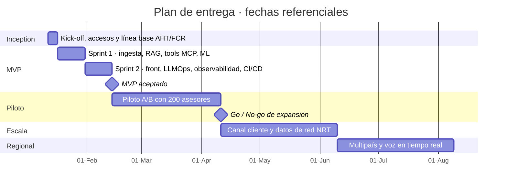

# 3. Gestión del proyecto

> Cómo llevar Claro Copiloto del MVP a producción: equipo, plan, gobierno, calidad, riesgos y adopción.
> Las fechas son referenciales (inicio tras aprobación); las cifras de esfuerzo son estimaciones de orden de magnitud.

## 3.1 Enfoque y metodología

| Aspecto | Decisión | Por qué |
|---|---|---|
| Marco de trabajo | **Scrum** con sprints de 2 semanas para producto + **Kanban** para operación (LLMOps/MLOps) | El producto evoluciona por incrementos demostrables; la operación (drift, feedback, incidentes) es flujo continuo |
| Descubrimiento y entrega | **Dual-track**: hipótesis validadas con datos (golden, feedback, piloto) antes de construir | En IA generativa la calidad no se especifica de antemano: se mide |
| Ciclo de vida de IA | Prompts, modelos y documentos tratados como **artefactos versionados** con gate de calidad | Evita regresiones silenciosas al cambiar un prompt o un modelo |
| Entrega | **Trunk-based development**, CI/CD con despliegue canary | Lead time < 30 min y rollback inmediato |
| Documentación | **Docs-as-code** (este documento se genera desde Markdown en el repo) | Arquitectura y código evolucionan juntos y quedan versionados |

## 3.2 Plan de entrega

| Fase | Duración | Objetivo | Entregables | Criterio de salida |
|---|---|---|---|---|
| **Inception** | 1 semana | Alinear alcance, accesos y línea base | Backlog priorizado, accesos a fuentes y APIs, medición base de AHT/FCR, plan de datos con el DPO | Backlog y línea base aprobados por el PO |
| **MVP** | 4 semanas (2 sprints) | Copiloto funcional para asesores | 9 casos de uso, pipelines, tableros, IaC, CI/CD | Criterios de aceptación de 3.7 |
| **Piloto** | 8 semanas | Medir impacto real | Informe A/B de AHT, FCR, escalamiento y retención; ajustes de prompts y contenido | Metas de negocio alcanzadas o plan de corrección aprobado |
| **Escala** | ~3 meses | Más canales y señales | Chat/WhatsApp cliente, red near real time, autoscaling, cuotas LLM | SLO de 99,5 % y costo por conversación dentro de presupuesto |
| **Regional** | 6+ meses | Escala Claro | Multipaís por tenant, voz en tiempo real, fine-tuning si se justifica | Business case por país |

## 3.3 Estructura de trabajo (épicas del MVP)

| Épica | Sprint | Fases del caso que cubre | Resultado verificable |
|---|---|---|---|
| E1 · Plataforma base | 1 | 10, 13 | `docker compose up` levanta todos los servicios; Terraform valida |
| E2 · Integración CRM/Facturación | 1 | 4 | Mocks fieles al OpenAPI (429, 503), tools MCP con reintentos y timeouts |
| E3 · Ingesta y contenido no estructurado | 1 | 5, 6 | Catálogo v2 indexado y citado sin intervención; frescura medida |
| E4 · RAG y agente | 1–2 | 7 | Golden ≥ 80 %, citas en el 95 % de respuestas, HITL en acciones con efecto |
| E5 · Modelos de ML | 1 | 9 | Intención y churn en MLflow, servidos por API, drift monitoreado |
| E6 · Experiencia del asesor | 2 | 3 | Angular con streaming, citas, ficha, 👍/👎 y escalamiento |
| E7 · LLMOps y monitoreo de agentes | 2 | 8, 11 | Trazas por paso, tableros, alertas, golden como gate |
| E8 · Calidad y seguridad | 1–2 | 12 | Cobertura ≥ 70 %, e2e, escaneos sin vulnerabilidades críticas, prueba de no exposición de PII |
| E9 · CI/CD y despliegue | 2 | 14, 15 | Pipeline completo con evidencia y rollback |

## 3.4 Equipo propuesto

| Rol | Dedicación MVP | Responsabilidad principal |
|---|---|---|
| **Líder técnico de IA** | 100 % | Arquitectura, decisiones técnicas, calidad del agente, interlocución con negocio |
| Ingeniero(a) de IA / LLM (×2) | 100 % | Agente, RAG, prompts, evaluación, guardrails, MCP |
| Ingeniero(a) de datos | 100 % | Ingesta, extracción, PII, chunking, versionado y linaje |
| Científico(a) de datos | 50 % | Modelos de intención y churn, MLflow, drift, fine-tuning comparativo |
| Desarrollador(a) full stack (Angular) | 100 % | Interfaz del asesor y API de presentación |
| Ingeniero(a) DevOps / plataforma | 100 % | Contenedores, IaC, CI/CD, observabilidad, FinOps |
| QA automatización | 50 % | Pruebas e2e, integración y regresión del golden dataset |
| **Product Owner** (Claro, Servicio al Cliente) | 50 % | Prioridad del backlog, aceptación, piloto |
| Seguridad / DPO (Claro) | 20 % | Ley 1581, revisión de PII, accesos y auditoría |
| Dueños de contenido (Producto, Legal, NOC) | Bajo demanda | Fuente oficial de documentos y validación de respuestas |

Esfuerzo estimado del MVP: ≈ 7 FTE × 5 semanas (inception + 2 sprints) ≈ **35 semanas-persona**.

## 3.5 Matriz RACI

R = responsable · A = aprueba · C = consultado · I = informado

| Entregable | Líder IA | Ing. IA | Ing. datos | Cient. datos | Full stack | DevOps | QA | PO | Seguridad/DPO |
|---|---|---|---|---|---|---|---|---|---|
| Arquitectura y ADR | **A/R** | C | C | C | C | C | I | I | C |
| Prompts, agente y evaluación | A | **R** | I | C | I | I | C | C | I |
| Ingesta, PII y linaje | A | C | **R** | I | I | C | C | I | C |
| Modelos de ML | A | C | C | **R** | I | C | C | I | I |
| Interfaz del asesor | A | C | I | I | **R** | I | C | C | I |
| IaC, CI/CD y observabilidad | A | I | I | I | I | **R** | C | I | C |
| Seguridad y cumplimiento Ley 1581 | R | C | C | I | I | C | C | I | **A** |
| Contenido documental oficial | I | C | C | I | I | I | I | **A** | I |
| Criterios de aceptación y piloto | R | C | C | C | C | C | C | **A** | C |
| Decisión de paso a producción | R | I | I | I | I | C | C | **A** | C |

## 3.6 Gobierno y ceremonias

| Instancia | Frecuencia | Participantes | Propósito |
|---|---|---|---|
| Daily | Diaria · 15 min | Equipo | Avance y bloqueos |
| Planning / Review / Retro | Cada sprint | Equipo + PO | Planear, demostrar con métricas del golden, mejorar |
| **Comité de calidad de IA** | Semanal | Líder IA, Ing. IA, Cient. datos, PO | Revisar respuestas con 👎, groundedness, drift, costo y alertas de agentes; aprobar cambios de prompt o modelo |
| Revisión de contenido | Quincenal | Dueños de contenido, Ing. datos | Vigencia de documentos, versiones y huecos de conocimiento |
| Comité directivo | Mensual | Sponsor, PO, Líder IA | KPIs de negocio, presupuesto, riesgos y decisiones de alcance |

**Control de cambios de IA.** Todo cambio de prompt, modelo, umbral o documento sigue el mismo flujo que el código: pull request → evaluación automática con el golden → revisión → despliegue canary. Los cambios que bajan una métrica del gate no se despliegan.

## 3.7 Criterios de aceptación del MVP

| Dimensión | Criterio |
|---|---|
| Funcional | Los 9 casos de uso demostrados de punta a punta, incluida la demo del catálogo v2 |
| Calidad LLM | Exactitud golden ≥ 80 % · groundedness ≥ 0,85 · recall@k ≥ 0,90 · respuestas sin cita ≤ 5 % |
| Agentes | Éxito de tareas ≥ 90 % · errores de tools ≤ 3 % · **0** acciones con efecto sin confirmación · **0** bucles no cortados |
| Técnica | p95 ≤ 2 s al primer token y ≤ 8 s total · frescura documental ≤ 15 min |
| ML | F1 macro de intención ≥ 0,80 · churn con AUC reportado y plan de mejora · drift monitoreado con alerta |
| Seguridad | **0** PII en respuestas, logs y trazas (prueba automática) · roles aplicados · secretos fuera del código |
| DevOps | Cobertura ≥ 70 % · 0 vulnerabilidades críticas · lead time < 30 min · rollback probado |

**Definition of Ready.** Historia con criterio de aceptación medible, preguntas de evaluación asociadas (golden) y datos o accesos disponibles.

**Definition of Done.** Código revisado, pruebas en verde, golden sin regresión, trazas y métricas instrumentadas, documentación actualizada y desplegado en el ambiente de pruebas.

## 3.8 Registro de riesgos

| ID | Riesgo | Prob. | Impacto | Responsable | Mitigación | Disparador |
|---|---|---|---|---|---|---|
| R1 | Alucinación en tarifas o permanencias | Media | Alto | Líder IA | Cita obligatoria, validador de citas, umbral de confianza → escalar | Respuestas sin cita > 5 % |
| R2 | Exposición de PII | Baja | Alto | Seguridad/DPO | Presidio en ingesta y tools, masking en logs, prueba automática | Cualquier hallazgo en la prueba de PII |
| R3 | Acceso tardío a CRM real o a fuentes | Alta | Medio | PO | Mocks con contrato OpenAPI; integración real detrás de la misma interfaz | Accesos no listos al cierre de inception |
| R4 | Falla, latencia o cuota del proveedor LLM | Media | Medio | DevOps | Fallback multi-LLM, circuit breaker, degradación a modo búsqueda | Errores 429/5xx > 2 % |
| R5 | Baja adopción de asesores | Media | Alto | PO | Champions por equipo, capacitación, feedback visible en la UI | 👍 < 70 % o uso < 50 % en el piloto |
| R6 | Contenido desactualizado o contradictorio | Media | Medio | Dueños de contenido | Versionado, filtro de vigencia, revisión quincenal | Preguntas sin respuesta recurrentes |
| R7 | Costo por encima del presupuesto | Baja | Medio | Líder IA | Ruteo por tarea, caché semántico, presupuestos por usuario | Costo/conversación > umbral 2 días seguidos |
| R8 | Degradación tras cambio de prompt o modelo | Media | Medio | Ing. IA | Gate golden en CI, canary, rollback de versión | Caída de exactitud o groundedness |
| R9 | Drift en los modelos de ML | Media | Bajo | Cient. datos | PSI con alerta, reentrenamiento programado | PSI > 0,2 |
| R10 | Churn bajo la meta de AUC | Alta | Bajo | Cient. datos | Uso solo como señal; nuevas variables y calibración en el piloto | AUC < 0,75 al cierre del piloto |

## 3.9 Supuestos y dependencias

| Tipo | Descripción | Responsable |
|---|---|---|
| Dependencia | Acceso de lectura a CRM y facturación (o APIs de integración) y credenciales de servicio | TI Claro |
| Dependencia | Cuotas del proveedor LLM y acuerdo de tratamiento de datos | Compras / Seguridad |
| Dependencia | Repositorio oficial de documentos con dueño por documento | Dueños de contenido |
| Dependencia | SSO corporativo para roles (asesor, supervisor, admin) | TI Claro |
| Supuesto | La identidad del titular se valida antes de consultar datos | Operación |
| Supuesto | Las cifras del business case se validan con la línea base de inception | PO |

## 3.10 Plan de piloto y medición

| Elemento | Definición |
|---|---|
| Diseño | A/B: 200 asesores con copiloto vs grupo control equivalente (canal, antigüedad, turno) |
| Duración | 8 semanas: 2 de estabilización + 6 de medición |
| Métricas primarias | AHT, FCR, % escalamiento a N2, tasa de retención en intención de cancelar |
| Métricas de salud | 👍, groundedness, latencia, costo por conversación, incidentes de seguridad |
| Criterio de expansión | AHT −15 % o mejor con significancia estadística, sin degradar FCR ni satisfacción, y 0 incidentes de PII |

## 3.11 Gestión del cambio y adopción

- **Champions** por equipo de asesores que prueban primero y canalizan feedback.
- **Capacitación** de 2 horas: cómo leer las citas, cuándo confiar, cómo confirmar acciones y cómo reportar errores.
- **Transparencia**: el copiloto siempre muestra la fuente; el asesor decide.
- **Feedback visible**: los 👎 generan casos de evaluación y el equipo publica qué se corrigió cada sprint.
- **Comunicación**: boletín quincenal con KPIs del piloto para asesores, supervisores y dirección.

## 3.12 Gestión de la configuración y versiones

| Artefacto | Versionado | Dónde |
|---|---|---|
| Código e IaC | Git, versionado semántico, tag por despliegue (SHA) | Repositorio |
| Imágenes Docker | Tag = SHA del commit | GHCR / ACR |
| Prompts | Archivos YAML con versión semántica, registrada en cada traza | Repositorio |
| Modelos de ML | MLflow model registry (Staging → Production) | MLflow |
| Documentos fuente | `doc_id` + versión + hash, vigencia | Qdrant + MongoDB |
| Golden dataset | Versionado junto con el código; solo crece con casos revisados | Repositorio |

## 3.13 Plan de comunicación

| Audiencia | Qué | Canal | Frecuencia |
|---|---|---|---|
| Sponsor y dirección | KPIs de negocio, presupuesto, riesgos | Comité directivo | Mensual |
| Product Owner | Avance, demo, métricas de calidad | Review de sprint | Quincenal |
| Asesores y supervisores | Novedades, correcciones, buenas prácticas | Boletín y champions | Quincenal |
| Seguridad / DPO | Hallazgos, auditoría, cambios en datos | Reunión de cumplimiento | Mensual |
| Equipo técnico | Alertas, incidentes, decisiones | Canal del equipo y ADR | Continuo |
