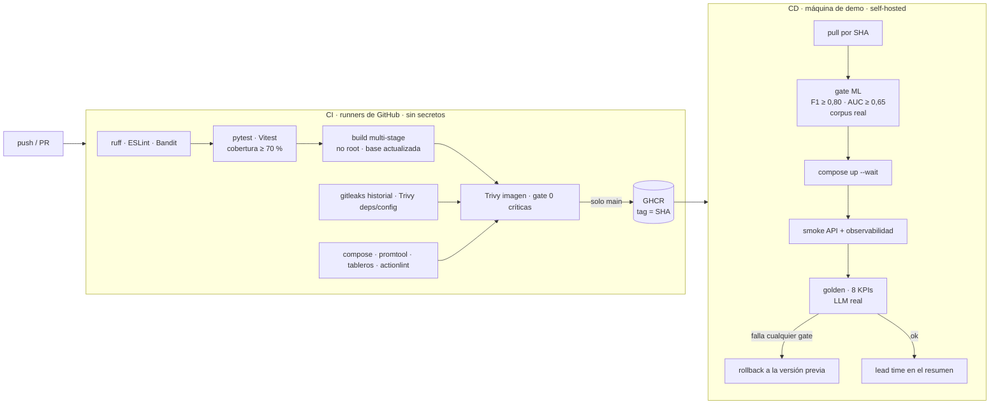

# CI/CD · Claro Copiloto

Implementa el SAD 2.13 con GitHub Actions: **CI** en runners de GitHub (sin secretos) y **CD** en un self-hosted runner
en la máquina de demo, con gates de calidad y rollback automático.



## Qué corre dónde y por qué

| Etapa | Dónde | Motivo |
|---|---|---|
| Lint, pruebas, cobertura, Bandit, build e imágenes escaneadas | GitHub (`ci.yml`) | No necesitan secretos ni insumos: seguro para PRs de forks |
| Pruebas con insumos (contratos de CRM/Facturación, corpus real de ML) | Se **omiten** en GitHub; el gate de ML corre en CD | `data/raw` son insumos de la prueba: el repo es público y no se versionan |
| Gate de ML, smoke, golden, despliegue | Máquina de demo (`cd.yml`) | Necesitan el `.env` (clave de OpenAI), los insumos y la solución levantada |

## Gates de calidad

| Gate | Umbral | Dónde |
|---|---|---|
| Cobertura de pruebas | ≥ 70 % por proyecto (Python y Angular) | CI |
| Lint y estilo | ruff, ESLint (con reglas de accesibilidad) sin errores | CI |
| Código inseguro | Bandit sin hallazgos de severidad media o alta | CI |
| Secretos | gitleaks sobre todo el historial: 0 | CI |
| CVEs | **0 críticas** en dependencias y en cada imagen (Trivy); altas y críticas a *code scanning* | CI |
| Contenedores | Usuario no root en todas las imágenes | CI |
| IaC y configuración | `docker compose config`, `promtool test rules`, tableros generados = versionados, actionlint | CI |
| ML | F1 macro intención ≥ 0,80 (GroupKFold) · AUC churn ≥ 0,65 sobre el corpus real | CD |
| Funcional | `smoke_api.py` (12) y `smoke_observabilidad.py` (9) | CD |
| RAG / agente | Golden: exactitud ≥ 80 %, groundedness ≥ 0,85, recall ≥ 0,90, sin cita ≤ 5 %, tareas ≥ 90 %, 0 acciones no permitidas, p95 ≤ 2 s / 8 s | CD |

Si falla cualquier gate de CD, el job vuelve a la versión que estaba corriendo (mismo `docker compose`, tag anterior),
verifica con el smoke de la API y deja el aviso en el resumen. Despliegue sin caída en Azure: revisiones de Container Apps
con tráfico 10 % → 100 % (bloque `feat/terraform`).

## Hallazgos al montar el pipeline

- **Trivy en la imagen del front:** la base `nginx-unprivileged:1.29-alpine` tenía 1 CVE crítica y 56 altas; la estable
  1.30.6 aún trae 4 críticas en nginx (corregidas en 1.30.7, sin imagen publicada) → mainline 1.31.7 + `apk upgrade`:
  0 críticas y 0 altas. Las imágenes Python solo tenían 1 alta (zlib), que se corrige construyendo con `--pull`.
- **gitleaks:** 10 hallazgos en el historial, todos falsos positivos revisados uno a uno (marcadores de `.env.example`,
  claves de los dobles de prueba, nombres de archivo): excepciones estrechas en [.gitleaks.toml](../.gitleaks.toml).
  `.env` nunca estuvo en el historial.
- **Bandit:** 16 hallazgos de severidad media ya justificados para ruff (`noqa: S104/S310/S108`: escuchar en `0.0.0.0`
  dentro del contenedor, `urlopen` a URLs locales fijas); se agregó el `# nosec` equivalente con el mismo motivo.
- **Cobertura sin insumos:** `ml/` caía a 68 % porque la comparación SVM vs LLM y el informe Evidently no tenían pruebas
  (0 %, con o sin insumos) → pruebas con datos sintéticos y LLM simulado: 94 %.

- **Primer despliegue real (rollback probado):** falló la descarga desde GHCR (`docker login` → *denied*) y el job volvió
  solo a la versión anterior, verificada con el smoke de la API (12/12). Causa: Windows PowerShell 5.1 agrega CRLF al
  token al pasarlo por tubería a `--password-stdin`. Como los paquetes de un repo público son públicos, la descarga es
  anónima (sin login). Además, PowerShell 5.1 lee los scripts de los pasos como ANSI y `Out-File -Encoding utf8` escribe
  BOM: los scripts del CD son solo ASCII y `GITHUB_ENV`/`GITHUB_OUTPUT`/resumen se escriben con `AppendAllText`.
- **Dependabot:** el primer barrido abrió 7 PRs en minutos (Angular 22, que exige Node ≥ 22.22) y saturó los runners →
  revisión mensual, máximo 2 PRs por ecosistema e ignorar versiones mayores de Angular, Vitest, pandas y Python.

## Configurar el self-hosted runner (máquina de demo)

El repo es **público**: GitHub advierte que un PR de un fork podría ejecutar código en un self-hosted runner. Por eso:

1. En GitHub → *Settings → Actions → General → Fork pull request workflows*: **Require approval for all external
   contributors**.
2. *Settings → Environments → New environment* `demo` (opcional: *Required reviewers* con tu usuario).
3. *Settings → Actions → Runners → New self-hosted runner* (Windows x64) y seguir los comandos que muestra GitHub en
   una carpeta fuera del repo, p. ej. `C:\actions-runner`. Al configurarlo, agregar la etiqueta **`claro-demo`**.
4. En `C:\actions-runner\.env` (variables que el runner pasa a los jobs):
   ```
   COPILOTO_ENV_FILE=C:\BPM\SourceCode\claro-copiloto\.env
   COPILOTO_DATOS=C:\BPM\SourceCode\claro-copiloto\data
   ```
5. Iniciarlo **a mano** solo cuando se use (`run.cmd`), no como servicio; cerrarlo después de la demo.

Requisitos en la máquina: Docker Desktop, `py -3.13` y Git (ya instalados). El job copia el `.env` al checkout del
runner para el despliegue y lo borra al terminar; los volúmenes de datos (Mongo, Qdrant, MLflow…) son los mismos del
entorno local porque el proyecto de compose se llama igual (`claro-copiloto`).

## Uso en la demo (lead time < 30 min)

1. Cambio pequeño (p. ej. una versión de prompt) → PR → CI verde → merge a `main`.
2. CI publica las imágenes con el SHA → CD despliega, corre los gates y escribe en el resumen del job el **lead time**
   (commit → desplegado y validado) y la tabla del golden.
3. Para mostrar el rollback: `workflow_dispatch` con un SHA cuyo gate falle (o detener un servicio durante los smoke).

Manual: *Actions → CD (máquina de demo) → Run workflow* (permite elegir el SHA y omitir el golden).
